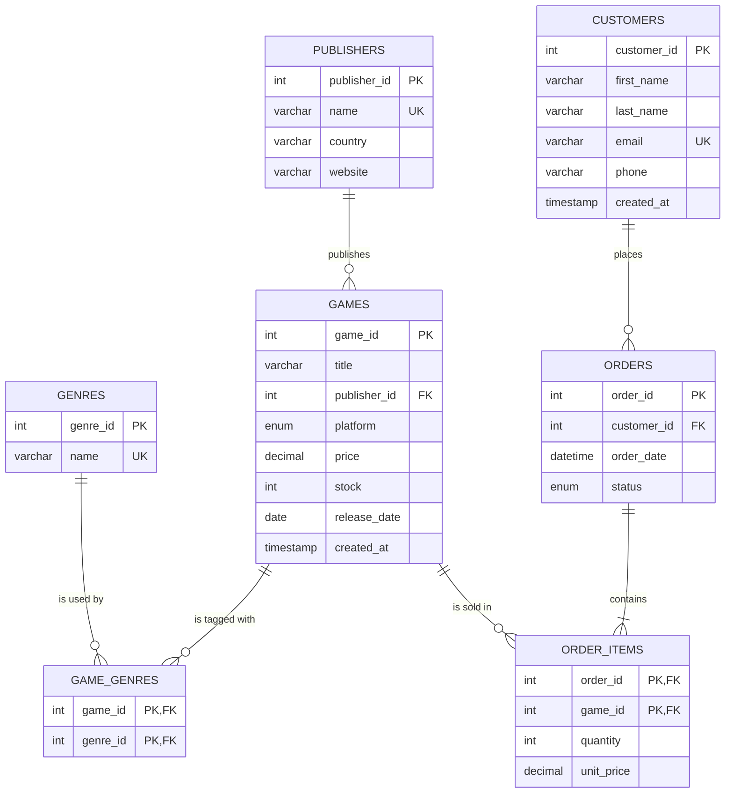

# Savepoint — Game Store

By La'Damian Cunningham. [Project repository](https://github.com/LCUNNIN4/savepoint-game-store).

[Updated project report](docs/Savepoint-Project-Report.pdf) · [Presentation rehearsal](docs/Presentation-Rehearsal.md)

A small video game store management system built on a relational database.
Staff can manage the game catalogue, publishers, genres and customers, and
place orders that automatically update stock.

| Layer    | Technology                                   |
|----------|----------------------------------------------|
| Database | MySQL 8                                      |
| Backend  | Python 3 + Flask (REST API, raw SQL through `mysql-connector-python`) |
| Frontend | HTML, CSS and plain JavaScript (`fetch`)     |

The Savepoint interface uses a charcoal and electric-green palette, a numbered
sidebar, stock alerts, and compact inventory tables. It runs with plain HTML,
CSS and JavaScript; no frontend package installation or build step is needed.


## Features

- Full **CRUD** (create, read, update, delete) for games, publishers, genres and customers
- Orders: create, view, complete, cancel, delete
- Stock is taken when an order is placed and put back when it is cancelled
- Order creation runs in a **transaction**: if any item is out of stock, nothing is saved
- Search games by title, filter by genre or publisher
- Dashboard with totals, top sellers and low-stock warnings
- Data integrity enforced by the database: primary keys, foreign keys, `UNIQUE`, `CHECK`, `ENUM`

## Database design

Seven tables plus one view. Full SQL is in [`database/schema.sql`](database/schema.sql).



(A PNG copy of this diagram is in [`docs/er-diagram.png`](docs/er-diagram.png).)

| Table         | Purpose                                              | Relationships |
|---------------|------------------------------------------------------|---------------|
| `publishers`  | Companies that publish games                         | one publisher has many games |
| `genres`      | Lookup list of genres                                | many-to-many with games |
| `games`       | Products for sale (price, stock, platform)           | belongs to one publisher |
| `game_genres` | Junction table: which game has which genre           | links `games` and `genres` |
| `customers`   | People who buy games                                 | one customer has many orders |
| `orders`      | One row per purchase, with a status                  | belongs to one customer |
| `order_items` | Junction table: which games are in which order       | links `orders` and `games` |
| `order_totals` (view) | Calculates each order's item count and total | built from `orders` + `order_items` |

The design is in third normal form (3NF): every non-key column depends only on
its table's primary key. Order totals are calculated by a view instead of being
stored, so they can never disagree with the line items.

## How to run it (re-creation steps)

### 1. Requirements

- [Python](https://www.python.org/downloads/) 3.10 or newer; Python 3.12 is recommended for reproducing the verified setup
- [MySQL Community Server](https://dev.mysql.com/downloads/mysql/) 8.0 or newer, running on your machine
- Git only if cloning the repository (not needed when using the ZIP)

**pip installs the Python packages.** MySQL Server must be installed and started
separately; the `mysql-connector-python` package is only the Python driver.

### 2. Get the code

Extract the ZIP and open a terminal in the `game-store` folder containing
`requirements.txt` and `app.py`. Or clone your repository:

```bash
git clone https://github.com/LCUNNIN4/savepoint-game-store.git game-store
cd game-store
```

### 3. Create a virtual environment and install with pip

`requirements.txt` pins the application packages and their dependencies to exact
versions. `requirements-dev.txt` adds pinned packages for the existing API tests.
These replace the original open-ended versions and separate `pip install pytest`
step. See pip's [repeatable installs guide](https://pip.pypa.io/en/stable/topics/repeatable-installs/).

The commands below use the environment's Python directly, so activation is
optional and PowerShell execution-policy changes are unnecessary. Always run
these commands from the `game-store` folder.

Windows (PowerShell or Command Prompt):

```powershell
py -3.12 -m venv .venv
.\.venv\Scripts\python.exe -m pip install -r requirements.txt
.\.venv\Scripts\python.exe -m pip check
```

If your installed Python has a different supported version, replace `-3.12`
with that version. If the `py` launcher is unavailable, use
`python -m venv .venv` with Python 3.10+ installed and on PATH.

macOS / Linux:

```bash
python3 -m venv .venv
.venv/bin/python -m pip install -r requirements.txt
.venv/bin/python -m pip check
```

Use Python 3.12 for the verified setup (for example,
`python3.12 -m venv .venv` when it is installed).

If you prefer activation, use the correct command for your shell:

| Shell | Activation command |
|-------|--------------------|
| Windows PowerShell | `.\.venv\Scripts\Activate.ps1` |
| Windows Command Prompt | `.venv\Scripts\activate.bat` |
| macOS / Linux (bash or zsh) | `source .venv/bin/activate` |

After activation, `python -m pip install -r requirements.txt`,
`python init_db.py` and `python app.py` are equivalent to the explicit paths
below. The report's `pip install -r requirements.txt` command also remains valid
inside the activated environment. See the [pip user guide](https://pip.pypa.io/en/stable/user_guide/)
and [Python venv documentation](https://docs.python.org/3/library/venv.html).

### 4. Tell the app how to log in to MySQL

Copy `.env.example` to a new file named `.env` and put in your own MySQL
user name and password:

| Shell | Copy command (first setup only) |
|-------|---------------------------------|
| Windows PowerShell | `Copy-Item .env.example .env` |
| Windows Command Prompt | `copy .env.example .env` |
| macOS / Linux | `cp .env.example .env` |

```
DB_HOST=127.0.0.1
DB_PORT=3306
DB_USER=root
DB_PASSWORD=your_mysql_password
DB_NAME=gamestore
```

Keep `DB_NAME=gamestore`: the SQL files create and use this database name.
The MySQL account needs permission to create this database and create/drop its
tables and view. Use a local demonstration database for this project.

`.env` is listed in `.gitignore`; do not add it to Git or include it in shared ZIPs.
Existing `DB_*` environment variables take precedence over values in `.env`.

### 5. Create the database, tables and sample data

Windows:

```powershell
.\.venv\Scripts\python.exe init_db.py
```

macOS / Linux:

```bash
.venv/bin/python init_db.py
```

This runs `database/schema.sql` and then `database/seed.sql`. **Running it again
drops and recreates the project tables, replacing existing data with sample data.**
Run it once for initial setup, or deliberately to reset your demo.

Prefer to do it by hand? Run the two files yourself instead, from MySQL
Workbench or a shell that supports input redirection (Command Prompt or bash,
not PowerShell):

```bash
mysql -u root -p < database/schema.sql
mysql -u root -p < database/seed.sql
```

### 6. Start the app

After the setup steps above, Windows users can double-click **Start Game Store.cmd**
in the project folder. Keep its window open while using the app. It starts the
local server without resetting your database.

Windows (terminal alternative):

```powershell
.\.venv\Scripts\python.exe app.py
```

macOS / Linux:

```bash
.venv/bin/python app.py
```

Open <http://127.0.0.1:5000> in your browser. Keep the terminal open; stop the
development server with Ctrl+C. On later runs, start MySQL, open a terminal in
`game-store`, and repeat only this startup command. You do not need to reinstall
packages or run `init_db.py` each time.

### 7. (Optional) Run the tests

**The tests reset the configured `gamestore` database to sample data and then
modify it.** Use a disposable demo database. MySQL must be running, but the Flask
server does not need to be running; pytest uses Flask's test client.

Windows:

```powershell
.\.venv\Scripts\python.exe -m pip install -r requirements-dev.txt
.\.venv\Scripts\python.exe -m pip check
.\.venv\Scripts\python.exe -m pytest tests -v
```

macOS / Linux:

```bash
.venv/bin/python -m pip install -r requirements-dev.txt
.venv/bin/python -m pip check
.venv/bin/python -m pytest tests -v
```

Run `init_db.py` again only if you want to restore the sample data after testing.

The pinned packages were verified on Windows with Python 3.12.14 and MySQL
8.0.46: clean pip installation, `pip check`, database initialization, and all
12 existing API tests passed. Other Python versions and operating systems have
not been run-tested for this update.

### Troubleshooting

| Problem | Fix |
|---------|-----|
| `Access denied for user ...` | The user name or password in `.env` is wrong. |
| `Can't connect to MySQL server` | MySQL is not running, or `DB_HOST` / `DB_PORT` is wrong. |
| `Unknown database 'gamestore'` | Complete step 5 using the virtual environment's Python. |
| `ModuleNotFoundError` | Use the same `.venv` Python for installation and startup, as shown in steps 3 and 6. |
| `pip` is not recognized | Use `.\.venv\Scripts\python.exe -m pip` on Windows or `.venv/bin/python -m pip` on macOS/Linux. |
| PowerShell blocks `Activate.ps1` | Use the explicit Python paths above; activation is optional. |
| Linux cannot create the environment (`ensurepip` missing) | Install your distribution's Python venv package, then repeat step 3. |
| Port 5000 is already in use | If this app is already running, open it in the browser. Otherwise stop the other server, or run `.\.venv\Scripts\python.exe -m flask --app app run --port 5001` and open port 5001. |

## API reference

All endpoints send and receive JSON. Errors look like `{"error": "message"}`.

| Method | URL | What it does |
|--------|-----|--------------|
| GET    | `/api/games` | List games. Optional `?search=`, `?genre_id=`, `?publisher_id=` |
| GET    | `/api/games/<id>` | Get one game |
| POST   | `/api/games` | Create a game |
| PUT    | `/api/games/<id>` | Update a game |
| DELETE | `/api/games/<id>` | Delete a game (refused if it appears in an order) |
| GET / POST | `/api/publishers` | List / create publishers |
| GET / PUT / DELETE | `/api/publishers/<id>` | Get / update / delete (delete refused if it has games) |
| GET / POST | `/api/genres` | List / create genres |
| GET / PUT / DELETE | `/api/genres/<id>` | Get / update / delete a genre |
| GET / POST | `/api/customers` | List / create customers |
| GET / PUT / DELETE | `/api/customers/<id>` | Get / update / delete (delete refused if they have orders) |
| GET    | `/api/orders` | List orders with customer name and total |
| GET    | `/api/orders/<id>` | Get one order with its line items |
| POST   | `/api/orders` | Create an order and take the stock |
| PUT    | `/api/orders/<id>` | Set status to `COMPLETED` or `CANCELLED` (cancel restores stock) |
| DELETE | `/api/orders/<id>` | Delete an order (restores stock if it was still pending) |
| GET    | `/api/stats` | Dashboard numbers |

Example: create a game

```bash
curl -X POST http://127.0.0.1:5000/api/games \
  -H "Content-Type: application/json" \
  -d '{"title": "Street Fighter 6", "publisher_id": 4, "platform": "PlayStation 5", "price": 59.99, "stock": 15, "release_date": "2023-06-02", "genre_ids": [1]}'
```

Example: place an order

```bash
curl -X POST http://127.0.0.1:5000/api/orders \
  -H "Content-Type: application/json" \
  -d '{"customer_id": 1, "items": [{"game_id": 10, "quantity": 2}, {"game_id": 8, "quantity": 1}]}'
```

HTTP status codes used: `200` OK, `201` created, `400` invalid input,
`404` not found, `409` conflict (duplicate, not enough stock, or blocked by a
foreign key).

## Project structure

```
game-store/
├── app.py              Flask app: registers routes, serves frontend, handles errors
├── config.py           Reads MySQL settings from .env
├── db.py               Connection pool + query / execute / transaction helpers
├── utils.py            Input validation helpers and the ApiError class
├── init_db.py          Runs schema.sql and seed.sql
├── requirements.txt    Pinned runtime packages for pip
├── requirements-dev.txt Pinned test packages (includes requirements.txt)
├── .env.example        Template for your MySQL login
├── database/
│   ├── schema.sql      Tables, constraints, index, view
│   └── seed.sql        Sample data
├── routes/             One file per resource (the REST API)
│   ├── games.py
│   ├── publishers.py
│   ├── genres.py
│   ├── customers.py
│   ├── orders.py
│   └── stats.py
├── static/             Frontend
│   ├── index.html
│   ├── style.css
│   ├── app.js
│   └── mark.svg          Savepoint icon
├── tests/
│   └── test_api.py     Automated API tests
└── docs/
    ├── game-store-report.pdf     Original project report
    ├── game-store-explanation.pdf Original explanation notes
    ├── er-diagram.png
    └── screenshots/
```

## Screenshots

Current Savepoint interface:


See [UI update notes](docs/UI-UPDATE.md) for the changes and code walkthrough.

## Notes

The accompanying [project report](docs/game-store-report.pdf) and
[explanation notes](docs/game-store-explanation.pdf) are included unchanged.
They describe the original UI, so their screenshots predate this redesign.
The current screenshots above and UI update notes document the new interface.
Their pip install and Python startup instructions still apply; use the steps
above for the complete environment setup and pinned test dependencies.

The game titles and publishers in the sample data are real, but the prices,
stock numbers, customers and orders are made up for demonstration.
